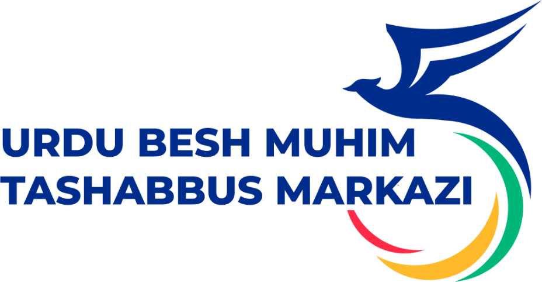

<div align="center">
  

  # UrDU 5 muhim tashabbus markazi — veb-portal

  Abu Rayhon Beruniy nomidagi Urganch davlat universiteti talabalari uchun to'garaklar, tanlovlar va yutuqlar portali.
</div>

---

## Imkoniyatlar

- **5 tashabbus** — har bir yo'nalish, uning to'garaklari, ko'rsatkichlari va sardori.
- **To'garaklar katalogi** — yo'nalish bo'yicha saralash va qidiruv (`togaraklar.html?t=3`, `?q=shaxmat`).
- **Tanlovlar** — muddat avtomatik hisoblanadi, har bir tanlov nizomi oynada ochiladi.
- **"Qaysi tashabbus sizga mos?"** — bosh sahifadagi 4 savollik test.
- **Ariza va murojaat** — shakllar markaz pochtasiga (`tashabbus@urdu.uz`) xat tayyorlaydi.
- **Sayt bo'ylab qidiruv** — `Ctrl + K`.
- **Yorug' / qorong'i rejim**, telefon va planshetga to'liq moslashgan.

## Sahifalar

| Fayl | Sahifa |
|------|--------|
| `index.html` | Bosh sahifa |
| `markaz.html` | Markaz haqida, 5 yo'nalish batafsil |
| `rahbariyat.html` | Markaz rahbari va sardorlar |
| `nizom.html` | Markaz nizomi |
| `yoriqnoma.html` | Qanday qatnashish va savol-javob |
| `togaraklar.html` | To'garaklar katalogi |
| `tanlovlar.html` | Tanlovlar va musobaqalar |
| `reyting.html` | Fakultetlar reytingi va shon-sharaf doskasi |
| `kutubxona.html` | Tavsiya etilgan kitoblar |
| `aloqa.html` | Kontaktlar va murojaat shakli |

## Tuzilishi

```
├── *.html            sahifalar (faqat o'ziga xos qismi)
├── css/main.css      yagona dizayn tizimi
├── js/data.js        BARCHA ma'lumotlar: tashabbuslar, to'garaklar, tanlovlar, odamlar...
├── js/site.js        umumiy qism: header, menyu, footer, qidiruv, modal oynalar
├── js/pages.js       har bir sahifaning dinamik bloklari
└── assets/images/    rasmlar
```

### Ma'lumotni o'zgartirish

Matn, raqam, to'garak yoki tanlov qo'shish uchun **faqat `js/data.js`** ni tahrirlang — barcha sahifalar o'zi yangilanadi.
Umumiy raqamlar (to'garaklar soni, talabalar soni, sovrinlar) tashabbuslar ma'lumotidan avtomatik hisoblanadi.

- **To'garak qo'shish** — `clubs` ro'yxatiga yangi obyekt. Murabbiy surati bo'lmasa, `photo` ni yozmang (bosh harflar ko'rsatiladi).
- **Tanlov qo'shish** — `contests` ro'yxatiga. `deadline` (YYYY-MM-DD) o'tgach, tanlov avtomatik "Qabul yopilgan" bo'ladi.
- **Menyu** — `js/site.js` dagi `NAV` ro'yxati.

## Ishga tushirish

Hech narsa o'rnatish shart emas:

```bash
python -m http.server 3000
```

So'ng brauzerda `http://127.0.0.1:3000` ni oching. Serverga joylash uchun `deploy.sh` va `nginx.conf.example` ga qarang.

## Aloqa

- [urdu.uz](https://urdu.uz) · Urganch shahri, Hamid Olimjon ko'chasi, 14-uy
- +998 (94) 981-69-99 · info@urdu.uz
